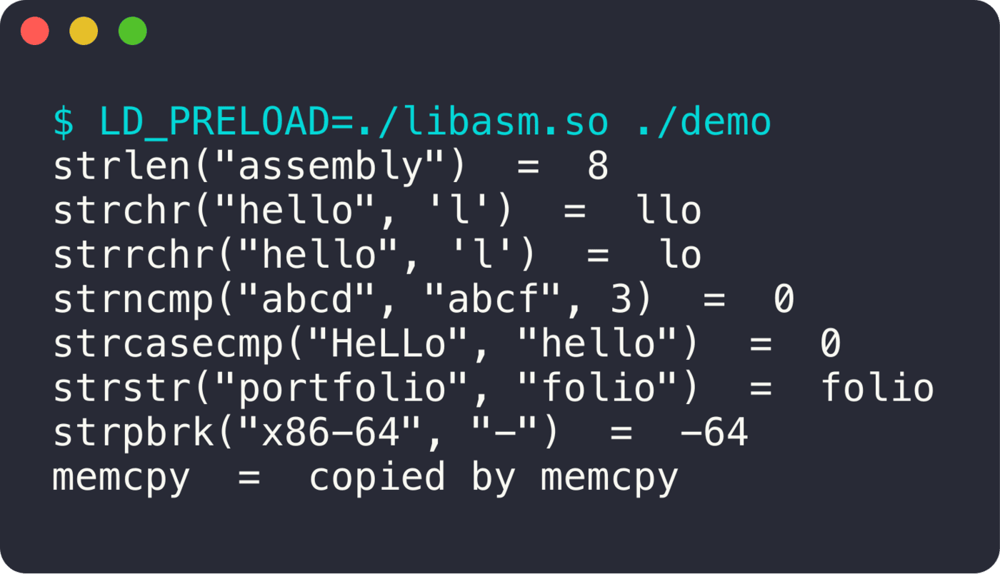

<div align="center">

# ASM MiniLibC

**Des fonctions de la libc réécrites en assembleur x86-64.**

  

<sub>Projet solo · 2024</sub>

</div>

<br/>

<p align="center"></p>

## Le projet en quelques mots

Une bibliothèque dynamique `libasm.so` en assembleur NASM, qui peut **remplacer la libc** d'un vrai programme grâce à `LD_PRELOAD`. Ci-dessus, un programme C classique dont tous les appels passent par mes fonctions.

## Ce que ça fait

- `strlen`, `strchr`, `strrchr`, `memset`, `memcpy`
- `strcmp`, `strncmp`, `strcasecmp`, `strstr`, `strpbrk`
- Convention d'appel **System V AMD64** respectée (registres, valeurs de retour)
- Utilisable directement avec `LD_PRELOAD` sur n'importe quel binaire

## Lancer le projet

```bash
make
LD_PRELOAD=./libasm.so ./ton_programme
```
